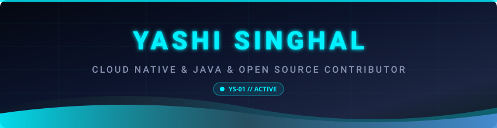

<!-- ======================= HEADER ======================= -->

<p align="center">
  
</p>

<p align="center">
  
</p>

<p align="center">
  <a href="https://linkedin.com/in/yashisinghal-java">
    
  </a>
  <a href="mailto:yashi.singhal410@gmail.com">
    
  </a>
  <a href="https://github.com/Yashisinghal285">
    
  </a>
</p>

---

<!-- ======================= UNIT PROFILE ======================= -->

## 🛰️ Unit Profile

<table width="100%">
<tr>
<td width="60%" valign="top">

```yaml
unit_designation: Yashi Singhal
class: Software Developer & Open Source Contributor
core_languages: [Java, TypeScript, JavaScript]
secondary_systems: [Python, SQL, Go]
specializations: [Backend Systems, GenAI Observability, Distributed Tracing]
status: ACTIVE — Open to SDE & Mentorship roles
origin: BCA Graduate, 2026
contributions: [CNCF (OpenTelemetry), Apache Software Foundation]
current_directive: >
  Architect resilient backend services, implement standard
  observability for modern GenAI stacks, and scale high-impact
  open source infrastructure.
```

</td>
<td width="40%" valign="top">

```text
        ___________
       /           \
      |   O     O   |
      |      ▽      |
       \___________/
        |    |    |
      __|____|____|__
     |  MODEL: YS-01 |
     |  ROLE: DEV    |
     |_______________|
          |     |
        [■]     [■]
```

</td>
</tr>
</table>

---

<!-- ======================= FEATURED CONTRIBUTIONS ======================= -->

## 🌌 Featured Open Source Contributions

<p align="center">
  
  
  
</p>

<br>

<table>
  <thead>
    <tr>
      <th>Organization / Repo</th>
      <th>PR / Contribution</th>
      <th>Key Impact / Highlights</th>
      <th>Status</th>
    </tr>
  </thead>
  <tbody>
    <tr>
      <td><b>OpenTelemetry</b><br><code>open-telemetry/opentelemetry-js-contrib</code></td>
      <td><a href="https://github.com/open-telemetry/opentelemetry-js-contrib/pull/3865"><b>#3865: Add TanStack AI Middleware</b></a></td>
      <td>Implemented GenAI semantic conventions (agent, chat, tool spans) with native ESM loader and concurrency-safe tool execution wrapping.</td>
      <td>🟢 In Review</td>
    </tr>
    <tr>
      <td><b>Apache Maven</b><br><code>apache/maven</code></td>
      <td><a href="https://github.com/apache/maven/pull/13447"><b>#13447: Fix JVM stderr notices into jvm.config</b></a></td>
      <td>Resolved core Maven 4 startup bug (#13405) by filtering out JVM stderr notices from being captured into config files.</td>
      <td>🟣 <b>Merged</b></td>
    </tr>
    <tr>
      <td><b>OpenTelemetry</b><br><code>open-telemetry/opentelemetry-js-contrib</code></td>
      <td><a href="https://github.com/open-telemetry/opentelemetry-js-contrib/pull/3740"><b>#3740: Native OTel Log Levels in Winston</b></a></td>
      <td>Supported native OpenTelemetry log levels and custom severity mapping in Winston logger instrumentation.</td>
      <td>🟣 <b>Merged</b></td>
    </tr>
    <tr>
      <td><b>OpenTelemetry</b><br><code>open-telemetry/opentelemetry-js-contrib</code></td>
      <td><a href="https://github.com/open-telemetry/opentelemetry-js-contrib/pull/3776"><b>#3776: Winston Transport Peer Dependency</b></a></td>
      <td>Added <code>@opentelemetry/winston-transport</code> as peer dependency to resolve runtime package resolution.</td>
      <td>🟣 <b>Merged</b></td>
    </tr>
    <tr>
      <td><b>OpenTelemetry</b><br><code>open-telemetry/opentelemetry-js-contrib</code></td>
      <td><a href="https://github.com/open-telemetry/opentelemetry-js-contrib/pull/3737"><b>#3737: Undici Network Protocol Version</b></a></td>
      <td>Added <code>network.protocol.version</code> semantic convention attribute tracking on Undici HTTP client spans.</td>
      <td>🟣 <b>Merged</b></td>
    </tr>
  </tbody>
</table>

---

<!-- ======================= CORE SYSTEMS ======================= -->

## ⚙️ Core Systems & Tech Stack

<p align="center">
  
</p>

<br>

<p align="center">
  
  
  
  
  
</p>

---

<!-- ======================= ACTIVE MISSIONS / PROJECTS ======================= -->

## 🚀 Featured Personal Projects

<table width="100%">
<tr>
<td width="50%" valign="top">

### 🛰️ ClientFlow CRM
Full-stack CRM control center for managing enterprise leads, contacts, accounts, deals, and sales pipelines with real-time updates.

`Next.js` `TypeScript` `FastAPI` `PostgreSQL` `TailwindCSS`

</td>
<td width="50%" valign="top">

### 📡 NeuroTrade
A market intelligence platform aggregating company filings, real-time news streams, and analytical data for streamlined investment research.

`TypeScript` `APIs` `React` `FastAPI` `PostgreSQL`

</td>
</tr>
</table>

---

<!-- ======================= TELEMETRY ======================= -->

## 📊 Telemetry

<p align="center">
  
</p>

<p align="center">
  
</p>

---

<!-- ======================= FLIGHT PATH ======================= -->

## 🧭 Flight Path & Philosophy

<p align="center">
🌱 <b>Learn</b> &nbsp;→&nbsp; 💻 <b>Build</b> &nbsp;→&nbsp; 🐛 <b>Debug</b> &nbsp;→&nbsp; 🔀 <b>Contribute</b> &nbsp;→&nbsp; 🚀 <b>Improve</b>
</p>

<br>

> **"Build more than you talk. Read code written by others. Don't fear difficult codebases. Every contribution is a stepping stone."**

---

<!-- ======================= FOOTER ======================= -->

<p align="center">
  
</p>

<p align="center">
  <sub>⚡ End of transmission — thanks for stopping by.</sub>
</p>
